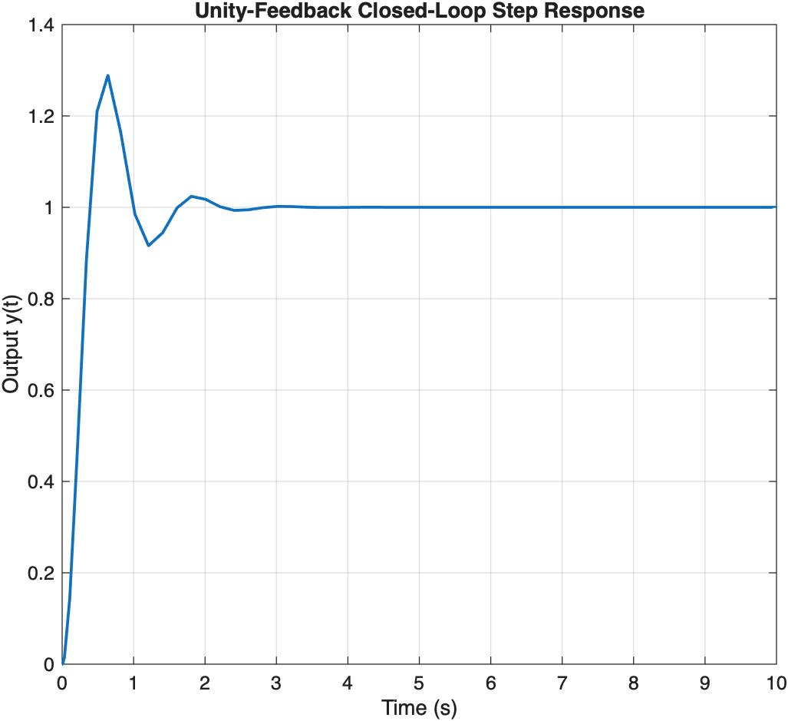

# matlab-simulink-control-system
Modeling and simulation of a closed-loop control system using MATLAB and Simulink.
# Closed-Loop Control System – MATLAB & Simulink

## Project Overview
This project demonstrates the modeling and simulation of a second-order control system with unity negative feedback using MATLAB and Simulink.

## System Model

The open-loop transfer function is:

G(s) = 30 / (s² + 4s)

With unity negative feedback, the closed-loop transfer function becomes:

T(s) = 30 / (s² + 4s + 30)

## Simulation
A unit step input is applied to evaluate the transient response and stability of the closed-loop system.

The simulation illustrates:
- Overshoot and oscillatory behavior
- Damped transient response
- Convergence to a steady-state output of 1
- Stable closed-loop behavior

## Simulation Results

## Tools
- MATLAB
- Simulink

## Repository Files
- `create_control_system.m` – MATLAB script that generates and simulates the model
- `closed_loop_control.slx` – Simulink model
- `step_response.png` – Simulation output

## Learning Objectives
- Transfer function modeling
- Negative feedback control
- Step response analysis
- Closed-loop stability
- MATLAB/Simulink automation
